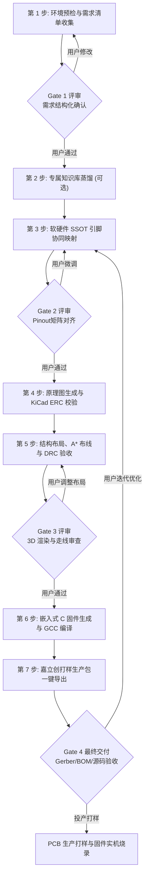

# AI-PCB Platform: 分阶段开发、验证与用户反馈门禁工作流指南 (Workflow & Quality Gates)

> 本指南定义了在 AI 编程 Agent（Claude Code, Antigravity, Codex, Grok）协同下，从用户提出硬件与固件需求到最终打样生产的 **标准 7 步闭环工作流** 与 **5 大评审门禁 (Quality Gates)**。

---

## 1. 总体流水线全景图



---

## 2. 各阶段详细执行规范与用户反馈机制

### 第 1 步：环境预检与需求清单收集 (Input & Preflight)
* **执行动作**：
  1. Agent 首先运行环境探针：`python3 scripts/preflight.py`，检测宿主机 `kicad-cli`、`arm-none-eabi-gcc`、`python3`；
  2. 若缺失工具，自动向用户展示一条复制即用的安装指令；
  3. 引导用户对照 [`REQUIREMENT_CHECKLIST.md`](./REQUIREMENT_CHECKLIST.md) 提供关键参数（尺寸、供电、MCU、外设、工艺要求）。
* **【Gate 1 需求评审门禁】**：
  - **交付物**：生成标准结构化模型 `spec.json` 与人类可读的《项目需求确认摘要》。
  - **用户反馈重点**：确认板框尺寸是否有空间干涉、工作电压与接口是否满足真实使用环境。用户确认“无误继续”后方可启动。

---

### 第 2 步：专属知识库蒸馏 (Knowledge Distillation)
* **执行动作**：
  - 若用户提供了特定芯片手册（Datasheet）、模块原理图、企业内部布线规范或外壳 CAD；
  - 运行蒸馏器：`python3 cli/ai_pcb.py distill <输入文档> --name <模块名>`；
  - 自动在 `skills/` 下生成专有 Skill，提炼出关键载流、封装间距、参考层开窗与去耦准则。

---

### 第 3 步：软硬件 SSOT 引脚协同映射 (Co-Design Pinout Matrix)
* **执行动作**：
  - 构建单一事实源 `pinout.json`，在原理图绘制前锁定 MCU 引脚功能复用（Alternate Functions）；
  - 严格核对外设电气特性（ADC 模拟引脚绝不与高频 PWM 复用，外部中断引脚留给按键/干簧管）。
* **【Gate 2 引脚对齐门禁】**：
  - **交付物**：`pinout.json` 与《软硬件引脚对照表》。
  - **用户反馈重点**：确认对外焊线焊盘位置与板外连线是否顺手、调试烧录点（SWD）是否易于探针接触。

---

### 第 4 步：原理图生成与官方 ERC 校验 (Schematic & ERC)
* **执行动作**：
  - 自动构建符合 KiCad 8.0/10.0 标准的 `.kicad_sch` S 表达式语法树；
  - 严谨建立供电符号、网络标签（Net Labels）、滤波去耦电容（按 0.1μF + 10μF 梯次配置）；
  - 执行官方电气检查：
    ```bash
    kicad-cli sch erc --format json -o erc.json project.kicad_sch
    ```
  - **硬性验收要求**：必须达到 **0 Errors, 0 Warnings**。

---

### 第 5 步：结构布局、A* 网格布线与 DRC 验收 (Layout, Routing & DRC)
* **执行动作**：
  1. **布局规划**：按“输入保护 -> 转换核心 -> 主控 MCU -> 功率驱动”信号流向单向排布，设定限高区与板边禁布区（Keepout）；
  2. **A* 拓扑布线**：执行逃逸引出与网格布线，电源线宽自适应加宽（如 0.30mm~0.50mm）；
  3. **45° 倒角钝角平滑**：全板转弯采用 $135^\circ$ 钝角倒角，彻底消除直角积酸与阻抗突变；
  4. **EMC/ESD 屏蔽**：板边四周每隔 3mm 环绕一圈接地法拉第屏蔽笼缝合孔，双面灌铜并自动剥离死铜孤岛 (`island_removal_mode = 0`)；
  5. **官方规则检查**：
     ```bash
     kicad-cli pcb drc --refill-zones --save-board --format json -o drc.json project.kicad_pcb
     ```
  6. **3D 模型渲染**：生成 Top / Bottom 高清 3D 渲染图。
* **【Gate 3 走线与 3D 审查门禁】**：
  - **交付物**：DRC 零违规报告、Top/Bottom 3D 效果图。
  - **用户反馈重点**：直观查看元器件高低排列、接插件出线方向、丝印极性是否醒目。如有微调需求，在此阶段即时修正。

---

### 第 6 步：嵌入式 C 固件生成与 GCC 编译 (Embedded C & Build)
* **执行动作**：
  - 基于 `pinout.json` 自动生成工业级嵌入式工程：
    - `Drivers/BSP/`：`bsp_gpio.c`, `bsp_adc.c`, `bsp_pwr.c`, `bsp_timer.c`
    - `Middlewares/`：按键防抖、电池电量滤波、状态指示灯闪烁引擎
    - `App/`：业务核心状态机主循环
    - `Makefile` / `CMakeLists.txt`
  - 调用交叉编译器执行严格编译检查：
    ```bash
    arm-none-eabi-gcc -Wall -Wextra -Werror ...
    ```
  - **硬性验收要求**：编译 0 报错，产出 `.bin` / `.hex` 固件。

---

### 第 7 步：嘉立创打样生产包导出与最终验收 (Release & Delivery)
* **执行动作**：
  - 一键调用导出引擎生成交付归档：
    1. `Gerber.zip`（含各铜层、阻焊、丝印、边框及 Excellon 钻孔）
    2. `pos.csv`（SMT 贴片坐标，严格过滤裸铜焊盘与测试点）
    3. `bom.csv`（物料采购清单，包含阻容精度、耐压与封装）
    4. `drill-report.txt`（钻孔规格明细）
* **【Gate 4 最终投产门禁】**：
  - **交付物**：生产打样 ZIP 包、固件源码工程、项目交付报告。
  - **后续持续演进**：用户在打样收到板卡或实机调测后，如有修改（如“按键阈值需调高”、“像管引脚需镜像”），可直接将实测反馈输入给 Agent，Agent 快速定位 `spec.json` 或 `pinout.json` 启动增量迭代，完成设计生命周期的闭环演进。
