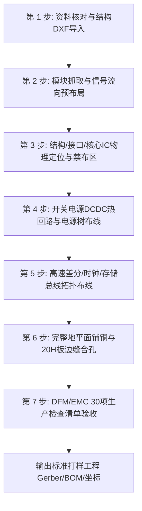

# PCB 工业级设计指导体系全景技能 (PCB Industrial Design Instruction Skill)

本技能汇聚企业级《PCB设计指南》56个主题分册与现代主流制造厂（嘉立创 JLCPCB 等）工程规范，涵盖设计全生命周期：从企业流程、结构DFM、走线拓扑、电源完整性、高密BGA、高速接口、存储器总线、8Gbps+超高速信号完整性到EMC/ESD防护与PCBA制造验收。

---

## 1. 核心架构与知识索引路由 (Topic Router)

当遇到具体的硬件设计任务、审查或疑难排查时，直接查阅对应的模块文档：

| 模块分册 | 对应文件 | 覆盖的核心内容与解答的问题 |
| :--- | :--- | :--- |
| **速查卡** | [`cheatsheet.md`](./cheatsheet.md) | 线宽载流对照表、差分阻抗几何速查、DDR 等长公差矩阵、8Gbps 设计参数 |
| **设计模式** | [`patterns.md`](./patterns.md) | 热回路最小化、BGA 狗骨扇出、法拉第笼包地、反焊盘开窗模式及 6 大设计反模式 |
| **专业词汇** | [`glossary.md`](./glossary.md) | 80+ 工业级 PCB/SI/EMC/DFM 专业术语中英文对照与精准定义 |
| **Ch 01** | [`chapters/ch01_enterprise_workflow_and_dfm_placement.md`](./chapters/ch01_enterprise_workflow_and_dfm_placement.md) | 规范的企业级设计流程、常规布局规范要求、符合可制造性（DFM）的装配间距 |
| **Ch 02** | [`chapters/ch02_general_routing_and_fanout.md`](./chapters/ch02_general_routing_and_fanout.md) | 通用布线军规：线宽线距、3W 原则、布线方式（防酸角）、过孔引出、等长蛇形、BGA 扇出 |
| **Ch 03** | [`chapters/ch03_power_management_dcdc_ldo_pmu.md`](./chapters/ch03_power_management_dcdc_ldo_pmu.md) | 电源系统：DCDC 开关热回路、SW 节点屏蔽、FB 包地、LDO 散热滤波、PMU 电源树与多相供电 |
| **Ch 04** | [`chapters/ch04_high_speed_serial_and_video_display.md`](./chapters/ch04_high_speed_serial_and_video_display.md) | 高速与显示：USB2.0/3.0、Type-C、HDMI、DP1.4、LVDS、RGB LCD、eDP、MIPI 差分与屏蔽 |
| **Ch 05** | [`chapters/ch05_peripheral_and_industrial_interfaces.md`](./chapters/ch05_peripheral_and_industrial_interfaces.md) | 外设与工业接口：SD/TF卡、SIM卡、Camera、SATA/PCIe、RJ45以太网隔离、RS232/CAN/485、光耦 |
| **Ch 06** | [`chapters/ch06_analog_audio_and_wireless_rf.md`](./chapters/ch06_analog_audio_and_wireless_rf.md) | 模拟音频与无线射频：音频与Class D功放、WiFi/BLE/RF 50Ω微带线与天线净空、晶振5大军规、复位 |
| **Ch 07** | [`chapters/ch07_memory_bus_routing_ddr.md`](./chapters/ch07_memory_bus_routing_ddr.md) | 存储器体系：Flash、eMMC、SDRAM、DDR2/DDR3（Fly-by拓扑/等长）、DDR4、LPDDR4 高速布线 |
| **Ch 08** | [`chapters/ch08_ultra_high_speed_8gbps_signal_integrity.md`](./chapters/ch08_ultra_high_speed_8gbps_signal_integrity.md) | 8Gbps+ 信号完整性：BGA 焊盘挖参考层 (R=10mil)、防玻纤编织效应 (10°~15°)、差分孔与伴随地孔、AC电容挖空 |
| **Ch 09** | [`chapters/ch09_emc_and_esd_protection_design.md`](./chapters/ch09_emc_and_esd_protection_design.md) | EMC/ESD 工业级防护：TVS直通拓扑、20H 边缘内缩、板边缝合地孔、EMC 布局布线检查建议 |
| **Ch 10** | [`chapters/ch10_dfm_and_pcba_assembly_checklist.md`](./chapters/ch10_dfm_and_pcba_assembly_checklist.md) | 可制造性与装配检查：PCB制板DFM检查（开短路/酸角/孔环/阻焊桥）、PCBA组装与波峰焊阴影检查 |

---

## 2. 核心参数黄金速查 (Quick Reference Rules)

```
┌─────────────────────────── 核心通用设计军规速查 ───────────────────────────┐
│ · 最小线宽 / 线距:  常规推荐 ≥ 0.127 mm (5 mil) ；0.5mm BGA 局部允许 3.5 mil  │
│ · 最小通孔钻孔:     0.25 mm (10 mil) [嘉立创常规免加价支持] ；外径 0.45 mm      │
│ · 导电铜皮到板边:   CNC 锣边 ≥ 0.30 mm (12 mil) ；拼板 V-CUT 线 ≥ 0.40 mm       │
│ · 绿油最小阻焊桥:   ≥ 0.10 mm (4 mil) ；杂色油墨(黑/白/蓝) ≥ 0.127 mm (5 mil)  │
│ · 50Ω 单端传输线:   参考 L2 GND 层，四层板常规板厚下线宽约 0.25 mm (10 mil)     │
│ · 90Ω USB 差分对:   线宽 0.15 mm (6 mil) ，间距 0.18 mm (7 mil) ，等长 ±5 mil   │
│ · 100Ω 差分线对:    线宽 0.127 mm (5 mil) ，间距 0.20 mm (8 mil) (HDMI/以太网) │
│ · 8Gbps+ 反焊盘:    BGA 焊盘正下方 L2 参考层开窗挖空半径 R = 10 mil (0.25 mm)  │
│ · 防玻纤编织效应:   差分线相对于基板编织经纬方向倾斜 10°~15° 走线或锯齿走线    │
│ · 过孔额定安全载流: 0.3mm 通孔约为 1.2~1.5A ；超过 1.5A 必须打并联多孔阵列     │
└─────────────────────────────────────────────────────────────────────────────┘
```

---

## 3. 标准企业级 PCB 设计闭环工作流 (Enterprise Workflow)



1. **第 1 步: 资料核对与结构导入**（详见 `ch01`）：
   - 核对分页原理图、元器件封装库、结构 DXF（锁定定位孔、接插件、限高 5mm 板边禁布区）。
2. **第 2 步: 模块抓取与信号流向预布局**（详见 `ch01`）：
   - 按电路功能页面抓取元件，绘制信号流向图，梳理“电源树”。
3. **第 3 步: 结构、接口与核心器件布局**（详见 `ch01`, `ch04`, `ch05`）：
   - 锁定接插件坐标，放置 ESD/TVS 管（直通拓扑）；放置主控 SoC、MCU，晶振紧贴引脚（`ch06`）。
4. **第 4 步: 开关电源热回路与功率走线**（详见 `ch03`）：
   - 最小化 Buck/Boost 开关脉冲回路，SW 节点短粗，采样 FB 走线远离电感并打地孔屏蔽。
5. **第 5 步: 高速差分与关键总线布线**（详见 `ch02`, `ch04`, `ch07`, `ch08`）：
   - 差分线严守 3W 原则与等长公差；换层伴随打地回流孔；8Gbps 焊盘正下方挖空参考层；避免直角酸角走 45° 倒角。
6. **第 6 步: 完整地平面铺铜与法拉第笼缝合**（详见 `ch02`, `ch09`）：
   - 保持参考地平面连续平整，严禁跨分割；板边沿 20H 内缩并打间距 2~4mm 的缝合孔。
7. **第 7 步: DFM/EMC 闭环检查与发厂导出**（详见 `ch10`, `cheatsheet.md`）：
   - 运行 DRC/ERC 保持 0 错误；核对最小阻焊桥、焊环尺寸、阻焊盖油；导出 Gerber、钻孔、BOM 和坐标。\n